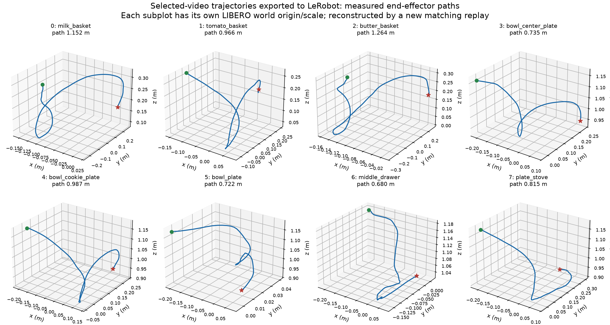

# 動画に対応する軌道のLeRobot変換・可視化

## 記録の由来と照合

最終統合動画で採用した8タスク各1エピソードについて、同じ学習済みモデル・乱数seed・初期状態でROS 2経由の再実行を行い、状態と動作指令を新規記録した。元の評価では各ステップの状態・指令を保存していなかったため、**元試行の未保存テレメトリを復元した資料ではない**。

再実行の正面動画は8本すべて元の採用クリップとMP4ファイルのSHA256が一致し、計973フレームの復号画像も完全一致した。初期状態のハッシュも8件一致し、8件とも成功・本実験の判定上で無衝突だった。これは映像の一致を示す検証であり、元の未記録の関節状態・動作指令との直接一致は検証できない。動画から関節角を推定したのではなく、再実行のシミュレーターから取得した。

[再実行の照合記録](replay_manifest.json) / [LeRobotデータセット](lerobot_dataset/) / [変換・読み戻し検証](lerobot_dataset/VERIFICATION.json)

## データ仕様

公式LeRobot 0.4.4の作成APIを使用したv3.0形式。8エピソード、973観測、965実行指令、正面・手首の2カメラ、20 Hz。各エピソードはN個の指令とN+1個の観測を持つ。最後の8行は終端観測で、actionのゼロ値は未実行の仮置き値である。再学習に利用する場合は必ず`action.valid`でマスクする。

|項目|内容・単位|
|---|---|
|observation.state|手先位置3（m）、axis-angle3（rad、LIBERO方式）、指関節2（m）|
|observation.joint_position / joint_velocity|腕7関節の観測値（rad / rad/s）|
|observation.eef_position / eef_quaternion_xyzw|LIBERO world座標の手先位置と姿勢|
|action|相対OSCの正規化指令7次元。並進3・回転3・グリッパー1。メートル／ラジアン値や7関節の角度指令ではない|
|action.valid / observation.terminal|実行指令の有効性／終端観測|
|observation.images.image / image2|正面／手首RGB、256×256。シミュレーター画像を180度回転して入力仕様に統一|
|timestamp|20 Hzに基づくシミュレーション時刻。実処理時間ではない|

両カメラはLeRobot出力時にH.264で再圧縮されるため、データセット内の映像と元映像の画素一致は主張しない。完全一致を検証したのは再実行MP4と元クリップである。数値は全行について生記録をfloat32に変換した値と照合した。LeRobotの読み込みでは各エピソードの先頭・中央・末尾24地点の両カメラを検証した。現環境のTorchCodec/PyTorch ABI不整合を避けるため、明示的な直接PyAV読み込みアダプターを使用している。データ形式自体は変更していない。

## 軌道の可視化

以下は**変換後のLeRobot Parquetから算出**した軌道。緑が開始、赤が終端。タスクごとにworld原点と図の縮尺が異なるため、位置や見かけの経路の長さを直接比較しない。経路長は観測した手先位置の隣接差分の長さの総和であり、最短経路や最適性を示さない。



各詳細図には手先3D経路・XYZ時系列・7関節角・7関節速度・相対OSC指令・グリッパー指令と指位置を掲載した。終端の仮置きactionは指令図から除外した。指位置は符号付き関節座標であり、開口幅そのものではない。

|タスク・詳細図|観測数|指令数|最終観測時刻(s)|手先経路長(m)|最大関節速度絶対値(rad/s)|
|---|---:|---:|---:|---:|---:|
|[milk_basket](figures/milk_basket.png)|131|130|6.50|1.152|0.686|
|[tomato_basket](figures/tomato_basket.png)|129|128|6.40|0.966|0.688|
|[butter_basket](figures/butter_basket.png)|139|138|6.90|1.264|1.099|
|[bowl_center_plate](figures/bowl_center_plate.png)|93|92|4.60|0.735|0.884|
|[bowl_cookie_plate](figures/bowl_cookie_plate.png)|116|115|5.75|0.987|0.864|
|[bowl_plate](figures/bowl_plate.png)|85|84|4.20|0.722|1.245|
|[middle_drawer](figures/middle_drawer.png)|157|156|7.80|0.680|0.752|
|[plate_stove](figures/plate_stove.png)|123|122|6.10|0.815|1.011|

[集計CSV](figures/motion_summary.csv) / [集計JSON](figures/motion_summary.json)

合計の状態時間は48.25秒、終端観測も各1フレーム含む元動画は48.65秒。今回の8件は動画用に選んだ成功例であり、80試行の性能評価を置き換えない。モデル性能・ROS 2最終評価の成績は[本編](../REPORT.md)を参照。実機動作の検証は行っていない。

## 読み込みと再現

公開作業フォルダの`backends/smolvla`環境から、付属アダプターを明示的に有効にして読み込める。

```python
from lerobot_video_compat import enable
from lerobot.datasets.lerobot_dataset import LeRobotDataset
enable()
ds = LeRobotDataset(
    repo_id="lemonydrink/smolvla-libero-selected-ros2-replays",
    root="/absolute/path/to/lerobot_dataset",
    video_backend="pyav",
)
frame = ds[0]
# 学習時は action.valid == False の行をlossから除外する。
```

作成コード：公開作業フォルダの`backends/smolvla/replay_selected_trajectories.py`、`export_replay_lerobot.py`、`lerobot_video_compat.py`、`scripts/plot_lerobot_trajectories.py`。元の評価記録とモデルは変更していない。大きい生HDF5はローカルに保管し、公開物には変換済みデータと照合記録を含めた。
