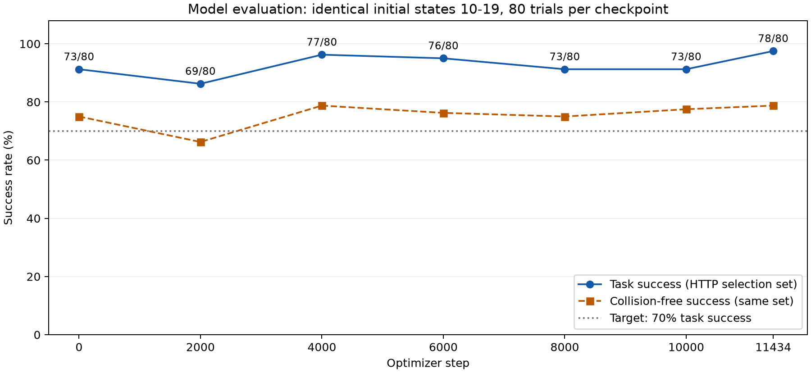

# BurgQ SmolVLAの8タスクSFTとROS 2実行を分けて評価した最終報告

[PDF版（5ページ）](REPORT_5P.pdf)

## 要旨

- **モデルの追加学習効果**：同じ80試行・同じ初期状態のHTTP評価で、公開BurgQモデルの73/80（91.25%）から、SFT後の78/80（97.5%）へ**6.25ポイント改善**した。無衝突成功率の改善は75.0%→78.75%の**3.75ポイント**であり、タスク成功率ほど大きくない。これは複数checkpointから選んだ結果で、独立した汎化性能の改善を確証する比較ではない。
- **最終ROS 2評価**：選択済みモデルを固定し、別の初期状態80試行をROS 2 DDS経由・2並列で実行した。**78/80成功（97.5%）、無衝突成功68/80（85.0%）、通信等のインフラエラー0件**。これはROS 2経由のシミュレーション実行が成立した証拠であり、ROS 2がモデルを高性能化した証拠ではない。
- **成果動画**：全8タスクから無衝突で成功したepisodeを1本ずつ選び、実際の指示プロンプトを左上に表示した48.65秒のMP4を作成した。動画8本の無衝突成功と、全80試行の無衝突成功率85.0%は異なる集計である。
- 目標70%はモデル比較・ROS 2最終評価の両方で上回った。ただし**公開BurgQモデル自身が学習前から91.25%**だった。実機でのタスク遂行は未検証である。

## 1. 何を検証したか

### 背景と着想

本実験の着想は、**PARCコンペにおいてSmolVLAでπ0.5に匹敵する性能を発揮した参加者がいたという報告**にある。これにインスパイアされ、軽量なSmolVLAでどこまで性能を引き出せるかを確かめ、**今回の8タスクと利用可能な計算資源の範囲で、SmolVLAで達成可能な最高性能を目指した**。成功率70%は最低限の到達目標として設定した。このPARCでの事例は実験の着想として参照しており、本報告内でその参加者の成績やπ0.5との同条件比較を検証したものではない。今回の実験でもπ0.5との直接比較は行っていない。

最初は公式の汎用ベースモデル`lerobot/smolvla_base`と公式のLIBERO-PLUSモデル`lerobot/smolvla_libero_plus`を使用したが、当初のSFT後の評価ではそれぞれ**1/80（1.25%）、5/80（6.25%）**と、期待する結果を残せなかった。LIBERO-PLUS系列で全データを1巡させた継続学習も**3/80（3.75%）**だった。この試行錯誤を経て、入力・学習条件の監査と修正、公開BurgQモデルへの切り替え、追加学習とrolloutによるcheckpoint選択へ進んだ。

これらの低い初期成績は、入力・lossの監査前の学習・評価系で得られた結果であり、公式モデル自体の性能の上限を示さない。実際に修正後の別系列では公式LIBERO-PLUSモデルのbaselineに80/80の記録がある。「最高性能を目指した」は実験の狙いを表し、今回の方式がSmolVLAの性能上限や全候補中の最高性能を達成したと実証する意味ではない。

対象はFranka Pandaのシミュレーションによる原案8タスクで、牛乳・トマトソース・バターの収納、ボウル3種の移動、引き出し、皿押しからなる。LIBERO-PLUS由来の対象データでSmolVLAをSFTし、最終的に8タスクの成功率70%以上と各タスクの成功動画を得ることを目的とした。

当初のX-VLA/2toINF参照系とROS 2導入から出発したが、最終的な学習方式は**SmolVLAのAction Expert中心のSFT**である。X-VLA参照モデルの成功率を今回の学習成果に含めていない。

本報告の「無衝突」は、非対象物の最大変位が1mmを超えた場合にcollisionとする既存のシミュレーション補助指標であり、接触センサーで全接触の不存在を確認した意味ではない。無衝突成功率は「タスク成功かつcollisionなし」の件数を予定80試行で割る。成功試行だけを分母にしない。

評価は以下の二つに分ける。

| 区分 | 検証したいこと | 初期状態 | モデル | 通信 | 扱い |
|---|---|---|---|---|---|
| モデル評価 | 追加学習前後でタスク成功がどう変化したか | 各タスクindex10〜19 | baselineと各SFT checkpoint | HTTP | 比較とcheckpoint選択に使う |
| 最終ROS 2評価 | 固定したbestモデルがROS 2経由でも実行できるか | 各タスクindex20〜29 | 選択済みbestのみ | ROS 2 DDS | 別試行でのシステム実行確認 |

最終ROS 2評価には、同じindex20〜29で測った公開モデルbaselineやHTTP版がない。したがって最終ROS結果だけからSFTの改善量や通信方式の因果効果を計算しない。

## 2. 実験の経緯と、比較可能な結果の整理

| 段階 | 実施内容・保存結果 | 今回の結論での扱い |
|---|---|---|
| 参照系の準備 | 既存X-VLA系、LIBERO環境、ROS 2 Jazzy、custom messageを用意 | 基盤構築。SmolVLA学習成果には数えない |
| 初期SmolVLA SFT | 汎用baseからのSFTは1/80、LIBERO-PLUS版からのSFTは5/80、全件1巡の継続学習は3/80 | 後述の入力・loss監査前の履歴。現行条件との直接比較には使用しない |
| 入力・学習監査後 | 画像向き、姿勢表現、有効7D loss、FP32重みとBF16 autocast、normalizerを整理 | 低成功率を単純にデータ量不足と解釈しない方針へ変更 |
| 段階的SFT系列 | 保存されたLIBERO-PLUS系列の修正後baselineは80/80、2,000更新は78/80。batch4×蓄積8からbatch32×蓄積1へ切替 | 別初期モデル・別系列の履歴。今回のBurgQが全候補で最良と実証したわけではない |
| BurgQ系列へ切替 | 先行実験を停止し、BurgQ公開重みからbaselineを測定、新しいoptimizerでSFT開始 | この系列内の比較を本報告の主要根拠とする |
| データ整合監査 | 元データ照合と軌道単位splitへ変更 | 検証lossの重複漏洩を修正し、学習再開 |
| checkpoint評価 | 2,000更新ごとと最終更新で各80試行。途中から4シミュレーター並列 | 同じ選択用初期状態を維持 |
| 最終確認と動画化 | 学習退出後、bestモデルをROS 2・2並列で別80試行。その後8タスクを動画統合 | 学習効果とは別にシステム実行と成果物を確認 |

初期系列の1/80から最終78/80までを「追加学習だけで96.25ポイント改善」と表現するのは不適切である。モデルの初期値、画像・state入力規約、loss、学習設定などが複数変わっている。履歴の数値は[過去系列の保存記録](evidence/history/)に残した。

## 3. 使用モデル、データ、学習の確定条件

### データ整合性と分割の修正

追加データは`Sylvest/libero_plus_lerobot`の指定8タスク、全3,071episode・404,716frameである。元の公開モデルが使用した`lerobot/libero`の数値データとも照合した。

- 全3,071本で、raw parquetと学習HDF5のstate/actionが一致し、指示文字列とfinite値を検査した。
- 3,013本では元LIBEROの340軌道と操作列全体がbit単位で一致した。残り58本について元LIBEROとの完全一致は主張しない。
- 各タスクの同一軌道で正面・手首の計16画像対を比較し、向きと時刻対応を確認した。画像の全frameを元データと比較したわけではない。PLUSには照明・背景・視点の変化がある。
- 元データ10HzとPLUS20Hzのメタデータ差はあるが、同じ長さの操作列と同一indexのstate対応を確認した。保存frameを間引いたりaction倍率を変更したりしていない。物理収録周波数まで同一と証明したものではない。
- 従来splitでは、検証306本すべての操作軌道が学習側にも存在した。タスク＋全操作列hashの350グループでsplitを再作成し、同一操作列グループの分割間重複を0にした。

| 分割 | Episode | Frame | 操作列グループ |
|---|---:|---:|---:|
| 学習 | 2,779 | 365,887 | 316 |
| 検証 | 292 | 38,829 | 34 |
| 合計 | 3,071 | 404,716 | 350 |

3,071本は互いに独立した3,071種類の操作軌道を意味しない。元軌道を共有する拡張episodeが含まれる。またBurgQの事前学習にも元LIBEROが含まれるため、splitを修正しても事前学習で未使用の評価にはならない。[データ監査](evidence/audit/dataset_alignment.json)

### 確定した学習条件

| 項目 | 実施値 |
|---|---|
| 初期モデル | `BurgQ/smolvla-libero-bs32-100k` |
| 初期revision | `238fb0654cd598e287f8b6c2d64bd09af239c76f` |
| 入力 / action | front・wrist RGB、state8D / relative OSC7D |
| 学習対象 | Action Expert＋state/action projections、trainable約99.88M parameters |
| VLM / vision | 凍結 |
| 重み / 演算 | 学習対象FP32保持 / BF16 autocast |
| Optimizer | AdamW、betas(0.9,0.95)、eps1e-8、weight decay1e-4 |
| Batch / accumulation | 32 / 1、effective batch32 |
| LR | peak3e-5、warmup572更新、cosine decay、最終3e-6 |
| Gradient clipping | norm1.0 |
| Loss | 有効な7 action次元・有効時刻のみ。paddingを除外 |
| 学習量 | 学習splitを1epoch、11,434 optimizer updates |
| Checkpoint | 2,000更新ごと＋最終更新 |
| 検証loss | 中間は各タスク8サンプル、計64。最後は検証38,829frame全件 |
| 正規化 | BurgQ付属のstate/action mean/stdを維持 |
| 記録 | W&B offline＋JSON/JSONL、config・loss・validation・LR・step・epoch・rollout |

2,000更新の保存後に並列評価へ切り替えるため再開したが、optimizer・学習順・乱数状態を復元した。ログ上のstep1〜11,434に欠番・重複がなく、[coverage](evidence/train-coverage.json)では学習365,887frameを各1回消化し、検証38,829frameを全件処理した。検証データで重みは更新していない。

モデル読み込みでは初期重み全500テンソルの一致、normalizer往復、padding次元にloss勾配が入らないことを監査した。画像は学習データをidentity、simulator生画像を両カメラ180度回転で合わせ、姿勢はrobosuiteのquat2axisangleに統一した。[設定](evidence/training_config.json) / [実行記録](evidence/train-run.json)

## 4. モデルの性能評価：同じ80試行でSFT前後を比較

### 比較条件

8タスク各10試行、最大300step、action_dt0.05秒、relative OSC7D。baselineと選択checkpointのprotocolはcheckpoint指定以外が一致し、**全80試行でseed・初期状態index・初期状態hashの一致を確認**した。途中から評価を並列化しているが、trial別RNGとaction queueを分離している。

公開モデルのbaselineを先に測定し、SFTした6個のcheckpointを同じ80試行で評価した。選択順は総成功数、同点時に最低タスク成功率・成功したタスク数・早いstepであり、無衝突成功率を確定条件する選択ではない。

### 推移と選択結果

| Optimizer step | 成功 | 成功率 | 無衝突成功 | 無衝突成功率 |
|---:|---:|---:|---:|---:|
| 0 | 73/80 | 91.25% | 60/80 | 75.00% |
| 2,000 | 69/80 | 86.25% | 53/80 | 66.25% |
| 4,000 | 77/80 | 96.25% | 63/80 | 78.75% |
| 6,000 | 76/80 | 95.00% | 61/80 | 76.25% |
| 8,000 | 73/80 | 91.25% | 60/80 | 75.00% |
| 10,000 | 73/80 | 91.25% | 62/80 | 77.50% |
| 11,434 | 78/80 | 97.50% | 63/80 | 78.75% |



2,000更新ではbaselineより低下し、4,000更新で77/80、最終11,434更新で78/80となった。8,000・10,000更新では73/80へ戻っており、更新数に対して単調に改善したわけではない。最終checkpointが、この系列のrollout選択基準ではbestだった。[全checkpoint集計CSV](checkpoint_results.csv)

### タスク別にどこが改善したか

| タスク | 学習前 | 学習後 | 成功率差（ポイント） | 無衝突成功の変化 |
|---|---:|---:|---:|---:|
| 牛乳→バスケット | 8/10 | 10/10 | +20 | 8/10 → 10/10 |
| トマトソース→バスケット | 9/10 | 10/10 | +10 | 9/10 → 10/10 |
| バター→バスケット | 10/10 | 10/10 | +0 | 10/10 → 10/10 |
| ボウル（中央）→皿 | 9/10 | 10/10 | +10 | 8/10 → 8/10 |
| ボウル（クッキー側）→皿 | 8/10 | 10/10 | +20 | 6/10 → 3/10 |
| ボウル→皿 | 10/10 | 10/10 | +0 | 10/10 → 10/10 |
| 引き出し | 9/10 | 10/10 | +10 | 9/10 → 10/10 |
| 皿押し | 10/10 | 8/10 | -20 | 0/10 → 2/10 |
| **合計** | **73/80** | **78/80** | **+6.25** | **60/80 → 63/80** |

同じ試行を対応付けると、失敗→成功が7件、成功→失敗が2件、成功維持が71件だった。全タスクが改善したわけではなく、皿押しは10/10→8/10へ低下した。ボウル（クッキー側）はタスク成功8/10→10/10と改善した一方、無衝突成功は6/10→3/10へ減っている。[タスク別CSV](task_results.csv)

したがって観測された改善は**タスク完了の安定性が中心**であり、無衝突性の改善は限定的である。無衝突成功は75.0%→78.75%（+3.75ポイント）。ここで最終ROS評価の85.0%を使って「モデルの無衝突性能が10ポイント改善」とはしない。

### Lossとrolloutを分けて判断する理由

同じ64サンプルによる中間validation lossは2,000更新0.541、4,000更新0.559、6,000更新0.621、8,000更新0.680、10,000更新0.728と上昇した。一方rollout成功数は同じ順で69、77、76、73、73と動き、最終checkpointは78だった。今回、lossの最小値を選ぶとrollout最良のcheckpointを選べなかった。

最終validation loss0.728は**全38,829frame**で算出しており、中間64サンプルの値と同一母集団の前後比較ではない。loss上昇だけで過学習やタスク性能低下を断定しない。選択基準は予定どおりrollout成功率とした。[学習metrics](evidence/training_metrics.jsonl)

### 改善量の解釈に必要な限界

成功率のWilson95%区間はbaseline83.0〜95.7%、選択checkpoint91.3〜99.3%。80試行を二項試行とみなす参考値で、タスク内の関連やcheckpoint選択の偏りを補正していない。

7件改善・2件悪化に対する探索的なexact McNemar参考値はp=0.180だが、**同じ80試行でcheckpointを選んだ後の計算なので確認的な有意差検定として用いない**。主張できるのは、この選択用80試行で+6.25ポイントの改善を観測したことまでである。

初期モデル自身が91.25%であり、SFTが70%到達の唯一の要因ではない。また別系列の修正後LIBERO-PLUS baselineには80/80の記録があるため、BurgQ初期値や今回の方式が全候補の中で最良とは結論しない。

## 5. 最終ROS 2評価：固定モデルで通信・実行系を検証

### 実装と独立した試行条件

学習とモデル選択の完了・プロセス退出後、best checkpointを固定し、ROS 2 DDS経由のシミュレーター2台で実行した。初期状態は選択用index10〜19から**index20〜29**へ切り替え、最終結果を見てモデルを選び直していない。

```text
SmolVLA（モデル1個、trial別RNGとaction queue）
  → local HTTP interpreter adapter → ROS 2 gateway
  → DDS ActionChunk（7D relative OSC）→ ROS 2 robot node
  → simulator driver
  → DDS Observation → gateway → SmolVLA
```

HTTPはPython環境間のローカルIPCとdriver境界に残るが、actionと観測は実際にDDSを通る。旧X-VLA用10D bridgeではなく、SmolVLA専用codecを使った。[最終protocol](evidence/final-ros2-best80/protocol.json)

### 最終結果

| タスク | タスク成功 | 無衝突成功 |
|---|---:|---:|
| 牛乳→バスケット | 9/10 | 9/10 |
| トマトソース→バスケット | 10/10 | 10/10 |
| バター→バスケット | 10/10 | 10/10 |
| ボウル（中央）→皿 | 9/10 | 9/10 |
| ボウル（クッキー側）→皿 | 10/10 | 5/10 |
| ボウル→皿 | 10/10 | 10/10 |
| 引き出し | 10/10 | 10/10 |
| 皿押し | 10/10 | 5/10 |
| **合計** | **78/80（97.5%）** | **68/80（85.0%）** |

全80試行でDDS受信action数とsimulator step数の一致を確認し、**合計9,782 action**を実行した。2個のnamespaceで動作し、インフラエラー0、全8タスクで成功動画を取得した。rollout本体のwall timeは514.6秒（約8分35秒）。simulator起動・モデル読み込み・集計等を含む全工程の時間ではない。[ROS 2結果](evidence/final_ros2_result.json) / [実行metadata](evidence/final-ros2-best80/execution.json)

この結果は、期限・sequence・model hash等の検査を通るROS 2経路で、固定した学習済みモデルが指定8タスクを遂行できたことを示す。通信エラーは失敗として分母に残す設計であり、失敗を成功まで再試行して置き換えていない。

### モデル評価と混同してはいけない点

- HTTP選択結果もROS 2最終結果も78/80だが、失敗の内訳は異なる。HTTPは皿押し2件、ROS 2は牛乳1件・ボウル（中央）1件である。
- 無衝突成功がHTTP63/80からROS 2で68/80へ増えたが、**初期状態と通信方式が同時に変わっている**。ROS 2による改善や、輸送層の完全な同等性を示す実験ではない。
- 同条件での通信方式比較には、同一モデル・同一index20〜29でHTTP版も実行する対照試験が必要。本実験では未実施である。
- この最終セットはcheckpoint選択用から分離したが、LIBEROの事前学習重複や基本8タスクに限られる点は変わらない。全LIBERO-PLUS摂動への頑健性を確認したわけではない。

### 実機移行について

episode/sequence、7D shape、finite値、action範囲、codec、checkpoint hash、観測鮮度を検査し、不正・期限切れの指令ではstopを呼び、resetまでfaultをラッチする。2台のMuJoCo環境で停止・復旧と実モデル10 actionの事前検証を行い、最終80回でも経路を確認した。[事前検証](evidence/ros2_preflight.json)

実機向けの測定pose基準のCartesian adapter、座標回転・速度・作業範囲・gripper制限・controller acknowledgementの境界も実装した。ただしvendor固有のFranka driver binding、実測カメラ/TCP校正、制御gain、独立watchdog・非常停止、実機の下位servoのcommissioningは未完了である。Python処理をハードリアルタイムservoとみなさず、nominalなsimulator dt0.05秒を実機の20Hz deadline保証としない。

**今回の結果から「実機でも必ず8タスクを遂行する」とは主張しない。**

## 6. 統合動画は8タスクとも無衝突成功を収録

[完成MP4：プロンプト付き8タスク・48.65秒](assets/final_ros2_eight_tasks_prompted.mp4)

各タスクで無衝突成功を優先し、それがない場合のみ衝突あり成功を採用する規則とした。実際には全8タスクで無衝突成功が見つかり、衝突あり成功へのfallbackは**0タスク**だった。失敗動画や通信障害動画では補っていない。

| 順番 | タスク | Episode番号 | 統合動画内の区間 |
|---:|---|---:|---:|
| 1 | 牛乳→バスケット | 0 | 0.00–6.55秒 |
| 2 | トマトソース→バスケット | 0 | 6.55–13.00秒 |
| 3 | バター→バスケット | 0 | 13.00–19.95秒 |
| 4 | ボウル（中央）→皿 | 1 | 19.95–24.60秒 |
| 5 | ボウル（クッキー側）→皿 | 0 | 24.60–30.40秒 |
| 6 | ボウル→皿 | 0 | 30.40–34.65秒 |
| 7 | 引き出し | 0 | 34.65–42.50秒 |
| 8 | 皿押し | 0 | 42.50–48.65秒 |

1280×720、20fps、973frame。各episodeを省略・切り貼りせず直結し、左上にモデルへ渡した正確な英語promptを表示した。source trial、モデルhash、衝突判定、元動画hash、各章の時刻を[動画manifest](evidence/video_manifest.json)へ保存し、今回の最終ROS 2評価のtrialと一致することを確認した。

この動画は成功例を選んだ**成果紹介**であり、8/8の選択結果を全試行での無衝突率100%と解釈しない。全試行での値は68/80＝85.0%である。

## 7. 何が達成され、何が残ったか

| 項目 | 達成状況 |
|---|---|
| BurgQから特定8タスクの1epoch SFT | 完了。11,434更新、学習frameの1巡をcoverageで確認 |
| 同条件でのモデル性能改善 | 観測上+6.25ポイント。checkpoint選択バイアスと小標本の制約あり |
| 70%目標 | モデル比較97.5%、最終ROS 2評価97.5%で上回る。ただし学習前も91.25% |
| ROS 2経由の2並列実行 | 80試行完了、DDS action整合、インフラエラー0 |
| 無衝突で成功する8タスク動画 | 全8タスクで収録。48.65秒の統合MP4完成 |
| 無衝突性の全面改善 | 未達。モデル比較では78.75%、最終ROS 2でも85.0%。特にクッキー側ボウル・皿押しが課題 |
| 輸送層だけの効果分離 | 未実施。同一モデル・同一初期状態でHTTP/ROS 2の対照が必要 |
| 実機の成功・安全性・制御周期 | 未検証。driver接続・実測校正・下位controllerの実機検証が必要 |

次に判断を進めるなら、学習量を増やす前に、同一モデル・同一初期状態でHTTP/ROS 2の対照を取り、接触/非対象物変位の失敗をタスク別に確認する価値がある。今回の結果だけでは、追加epochが成功率や無衝突性をさらに改善するとは言えない。

## 8. 証跡と再集計

一次資料は実験出力のtrial JSONであり、summaryをそのまま転記するだけでなく、**8評価run・計640試行**を再集計した。各runの80件・タスク各10件・重複なし・model/protocol単一・collision flag整合を確認し、summaryと突合した。

- [集計データ・対応付き比較・検証条件](analysis.json)
- [checkpoint別CSV](checkpoint_results.csv)、[タスク別CSV](task_results.csv)
- [baseline80](evidence/baseline80/)、[選択checkpoint80](evidence/eval-011434/)、[最終ROS 2の80試行](evidence/final-ros2-best80/)
- [configとplan](evidence/plan.json)、[学習実行記録](evidence/train-run.json)、[coverage](evidence/train-coverage.json)
- [再集計スクリプト](analyze_experiment.py)、[本文生成スクリプト](write_report.py)

グラフと表は同じ再集計値から生成した。本文に未実施の追加実験や架空の成功例は含めていない。モデル重み・学習HDF5・raw dataset・W&Bバイナリはレポートに同梱しない。

再集計例（元実験フォルダとPython環境がある場合）：

```bash
.venv/bin/python docs/experiment-final-report-run/analyze_experiment.py \
  --job backends/smolvla/runs/burgq-staged-batch32-run \
  --out docs/experiment-final-report-run
```

初期重みSHA256：`88638a6aa1399327d79418265b224b883e7af6b5a7855c3b0aa6b7929ff1f971`。最終重みSHA256：`7538f906c9988f5a5e500f7cb03d26ae12afb4504058888ffd695a81e6c1f050`。最終checkpointは`train-002/ckpt-011434`。これらはモデルの同一性の記録であり、実機での性能を保証するものではない。


## 9. 動画採用軌道のLeRobot形式データと可視化

[8タスクの軌道資料・データセット・照合記録](trajectories/README.md)を追加した。同条件のROS 2再実行の映像は元の採用8クリップと完全一致した。元評価の未保存テレメトリではなく、新規に記録した再実行データである。
