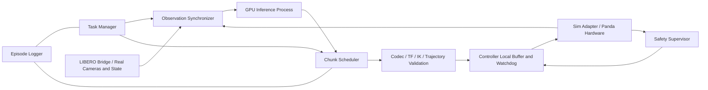
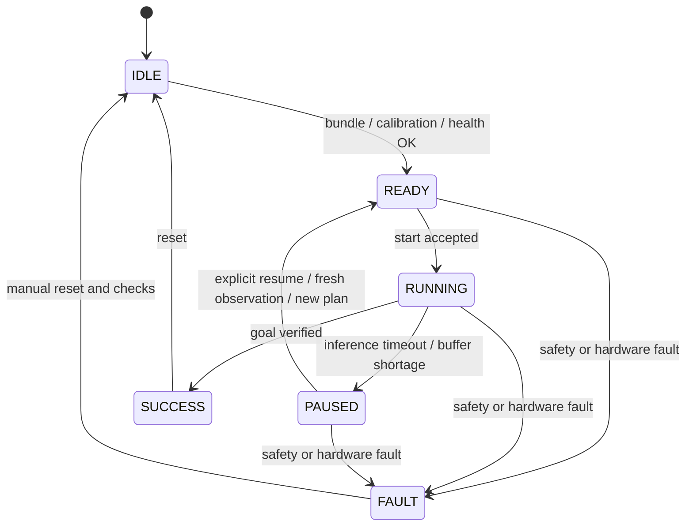

# 詳細要件定義書 v0.7


PARC照合結果：[PARC_CROSSCHECK.md](PARC_CROSSCHECK.md)。過去のコード・設定・実行記録を区別し、以下の追補を実装要件に含める。

## 最新モデル方針：SmolVLAへの切替

実験実施者の提案によりSmolVLAを主系統とする。本節は従来の2toINF版を使用する要件に優先する。X-VLAのコード・重み・評価結果は比較履歴として保持する。

- 初期点は汎用`lerobot/smolvla_base`、固定revision `5e8d12a6e2975b0e5e5fce7c8caf47c371d257b6`。LIBERO専用fine-tuned重みからの評価だけで今回の成果とはしない。
- 原案8taskのsimデータで**追加学習**し、同じSmolVLA初期点・同じ入力/正規化・同じ評価初期状態とpaired比較する。X-VLAの97.5%をSmolVLAの性能として扱わない。
- batch4を維持。初期手法はVLM/visionを固定したAction Expertとstate projectionのSFTとする。過去PARCのSmolVLA LoRA proxyとは異なる手法であり、予選の性能実証済み手法とは呼ばない。
- 入力：state8D、front/wrist2view。出力：公開データの7D相対OSC action。`state[t], action[t], image[t]`を使用し、X-VLAの絶対EE再構成を行わない。padding32Dはモデル内部のみ。
- 学習/推論依存は`backends/smolvla`へ分離する。LeRobotのNumPy2/Transformers4.57系と、既存MuJoCo側のNumPy1/旧Transformers系を同一venvへ混ぜない。
- 目標は追加学習後のモデルで成功率70%以上と全8task成功動画。損失低下・smoke完了は合格にしない。最終成功率と学習による変化を別に報告する。

## 最新スコープ確定：シミュレーションで完結

実験条件の確定により、**対象は原案8タスク、実機は使用せず全工程をシミュレーションで実施**と確定した。この節は下記の実機を前提とする記述に優先する。

- 70%は固定モデル・固定protocolによるLIBERO-PLUS/MuJoCoの8task macro task completion率で測定する。各10回/合計80回を初期protocolとする。collision指標は別記録し、task completionと混同しない。
- 動画はシミュレーションの8taskすべての成功実行を連続記録する。実機撮影ではない。
- Franka PandaはLIBERO内のシミュレーションロボット。FCI・実機カメラ・real controller・物理停止試験は今回の実装対象から外す。ROS 2の停止はsimのaction供給/時間進行の停止として検証し、実機安全性を主張しない。
- 初期評価環境は原案の意味タスクに一致する摂動なし基本BDDL。suite/BDDL/init stateのhashを保存し、LIBERO-PLUS全摂動での70%を意味しない。
- 起点は2toINF版、batch4。PARC由来のbody/controller frameは別profileで評価し、採用条件を記録する。
- 学習・推論PythonとROS Pythonは別プロセスとし、ローカルHTTP IPCとROS msgを介して接続する。今回の学習/シミュレーション用venvは既存PARCの環境から独立する。

## 0. 最新の目標と優先要件

本節は初期案および下記の競合する記述に優先する。実験実施者確定事項は **2toINF版を使用すること、成功率70%のモデルを得ること、8タスクすべての成功動画を撮影すること**。以下では実機の8タスクmacro平均70%以上として具体化する。実機での測定、macro平均か各task最低70%か、試行数は実装計画上の提案であり、実験実施者が明示指定した値とは区別する。

### 0.1 モデルと対象範囲

学習batch sizeは**4（実験条件）**。初期構成は単一GPU・gradient accumulation=1を提案し、この場合の実効batchは4とする。予選のbatch2は過去の再現条件として記録し、今回の設定には用いない。batch4のforward/backward・保存復元時のVRAM/host RAMを確認し、OOM時に無断でbatchを下げず、対処を記録して再検討する。

- 採用実装は **2toINF upstream版X-VLA**。初期checkpointは過去PARCと同じ`2toINF/X-VLA-Libero`、revision `129e71460678b7236cee6fc9707f09d9fa0c3590`を復元の第一候補とする。LeRobot版への移行は既定工程から外す。別revisionが必要なら理由と互換性を記録する。
- 対象は8タスクすべて。第3節の原案8taskを候補集合として保持するが、過去PARC T2とは異なるため、どちらの集合を採用するかD-13で確定する。撮影件数8件は確定事項とし再確認しない。
- まず1taskで接続・停止・撮影経路を検証し、その後全8taskへ展開する。1task成功だけでプロジェクト完了にしない。
- 既存モデルのbaselineを測り、必要なSFT・実機追加データ収集で改善する。学習を行う場合はW&B・依存lock・復元/export試験を維持する。

### 0.2 成功率70%の評価契約案

GOAL-01：凍結した単一model bundleと固定した実行設定を、実機8taskで評価する。各task成功率を`s_i/n_i`、主指標を`macro_success_rate = sum(s_i/n_i)/8`とし、**macro≥0.70**を合格条件案とする。全taskが個別70%以上という条件とは異なる。task別率・最小率・95%区間も必ず併記する。最終評価中の重み・codec・安全設定変更を禁止する。

GOAL-02：初期試行数案は**各task 10回、合計80回**。同数試行なら合計56成功以上でmacro70%に相当する。これは標本成功率の目標であり、真の成功率の95%下限70%を保証する条件ではない。推定精度が不足する場合は事前に試行数を増やす。試行数と初期条件表は評価開始前に固定する。

GOAL-03：対象task、物体、初期配置の分布、開始状態、達成状態、完了後の保持時間、timeout、人手準備と自律実行区間を事前定義する。8task各10回の全予定trialを記録し、成功試行だけを選んで成功率を計算しない。操作中の人手介入、policy停止、安全停止、task timeoutはそのtrialの非成功として理由別に記録する。開始前の機材不良はinfra errorとして別記録し、再試行規則を固定する。実行中infra errorは無言で除外せず、件数と失敗扱いした感度集計も報告する。

GOAL-04：checkpoint選択用の開発試行と最終評価の初期条件・trialを分離する。最終評価を見て調整した場合、その評価は開発扱いに変更し、新しい固定protocolで再評価する。動画の撮り直しを最終評価の失敗削除に利用しない。

### 0.3 8タスクの動画と納品

DEMO-01：**各8taskにつき最低1本**、ロボットの操作開始からGOAL-03の完了状態確認までを示す連続動画を保存する。途中の人手介入や別試行の継ぎ合わせを成功動画として扱わない。可能なら最終評価の成功trialから採用し、別撮影なら別trial IDとして明示する。

DEMO-02：納品物は凍結model bundle（差分時は取得可能なbase重み参照とhashを含む）、processor/codec/実行設定、80trial案の結果一覧・集計、8本以上の成功動画、実行ログ参照。各動画にtask key、日時、trial ID、model hash、達成条件と介入有無を対応付ける。公開・アップロードは別の要件時に行う。

DEMO-03：成功率合格と全task動画は独立した条件。macro70%を満たしても1taskの成功動画がなければ未完了。8taskの動画が揃っても固定評価70%未満なら未完了。

### 0.4 実装と完了ゲート

実機のlimits、座標系、校正、controller互換性、watchdog、停止試験は維持する。引き出し・押しも撮影範囲に含む場合は接触検証を先行する。base重み復元、機材利用可否、20/30 Hz差とrot6D整合は先行確認事項。全摂動suite・複数モデル比較・時間整列fusionは今回の必須納品条件にしない。

AT-GOAL：合意した8taskと固定protocolでGOAL-01〜04の70%条件を満たし、凍結bundleと全trial証拠が揃う。

AT-DEMO：8taskすべてについてDEMO-01〜03の成功動画と記録が揃う。AT-GOALとAT-DEMOの両方を満たして完了とする。第11節の旧80%・各30回・初期実機70%という別基準は本節へ置き換える。

工程は、資産・機材確認→対象集合確定→Codec/時間軸→1task sim/fake/低速実機→8task baseline→必要な学習と開発評価→bundle凍結→最終実機評価→全task動画・成果物整理とする。第13節のAT-01〜11を該当機能の接続・安全検証に使い、AT-GOAL/AT-DEMOを最終納品ゲートとする。

## 1. 文書の位置づけと範囲

本書は受領した技術設計書v1.0を、実装可能性の調査と受け入れ試験に使える要件へ詳細化した案である。原案より版番号が小さいのは、別系列の要件書であり、確定版ではないためである。

「必須」は本案の実装契約、「提案」は初期選択肢、「TBD」は証拠が必要な未確定項目を示す。要件の確定と試験の合格は別であり、現時点で本書の受け入れ試験は未実施である。

範囲は8タスクのデータ準備、Action Codec、SFT、直接推論評価、ROS 2シミュレーション、遅延耐性、Fake Hardware、実機校正と段階評価とする。自由文による任意タスク、複数ロボット、独自トルク制御器、安全認証、性能保証は初期範囲に含めない。今回の成果物は文書のみである。

## 2. 既存環境と再利用境界

| 項目 | 確認した事実 | 実装前に必要な確認 |
|---|---|---|
| ホスト | Ubuntu 24.04、x86_64（先行導入記録） | 実装開始時の再採取 |
| ROS 2 | `PhysicalAI/ros2/pixi.lock`が存在、Jazzy導入・送受信試験の先行記録 | バージョン・RMW・Python・C++ ABI採取 |
| GPU | 今回の`nvidia-smi`はドライバー通信エラー | ホストでのGPU認識、CUDA・VRAM・推論実測 |
| X-VLA重み | 今回は有無・完全性を未確認 | repo SHA、全shard、hash、ライセンス |
| 過去のpi0.5重み | 別プロジェクトのため本計画の初期重みに流用しない | X-VLA資産を独立して棚卸し |
| Panda・カメラ | 所有・接続・型式・FWを未確認 | 実機台帳と校正記録 |

ENV-01：学習、GPU推論、LIBEROランタイム、ROS 2、実機RT制御の依存を役割別に分離し、各環境のlock、OS、Python、CUDA、ソースrevisionを保存する。既存ROS 2環境への追加依存で既存ML環境を書き換えない。

ENV-02：RoboStackのROS 2はシミュレーション接続の出発点とする。Panda実機用`franka_ros2`・libfranka・RT kernelとの組み合わせは別の互換性ゲートを通す。Pixi環境で実機RT制御が成立すると仮定しない。

ENV-03：LIBEROを別Python/コンテナで実行する場合、ROS連携方式を固定する。提案はROS側adapterとLIBERO workerをversion付きIPCで接続する方式。ROSディストリビューションのPython ABIを跨いで`rclpy`を直接importしない。

## 3. 対象タスクと識別

| 原案dataset task_index | 指示（原案） | 区分 |
|---|---|---|
| 8 | Pick up the milk and place it in the basket. | 把持・配置 |
| 20 | Pick up the tomato sauce and place it in the basket. | 把持・配置 |
| 16 | Pick up the butter and place it in the basket. | 把持・配置 |
| 6 | Pick up the black bowl from table center and place it on the plate. | 把持・配置 |
| 4 | Pick up the black bowl next to the cookie box and place it on the plate. | 位置関係を含む配置 |
| 9 | Put the bowl on the plate. | 把持・配置 |
| 7 | Open the middle drawer of the cabinet. | 接触・引き出し |
| 36 | Push the plate to the front of the stove. | 接触・押し |

TASK-01：上表は候補対応表である。固定dataset revisionの`tasks.jsonl`と照合し、指示文・task_index・episode集合を確定する。不一致時に同じ数値の別タスクへ自動置換しない。

TASK-02：永続task keyを定義し、dataset index、suite、環境名、BDDL hash、摂動種別、初期状態集合、言語指示をmanifestで対応付ける。8タスクと摂動variantを別の集計軸にする。

TASK-03：実機では6つの把持・配置を先行する。引き出しと押しは力監視、治具、停止試験の完了後に有効化する。言語指示だけで未知のtask keyを登録できない。

## 4. データ要件

DATA-01：原案の`Sylvest/libero_plus_lerobot`を候補とし、実在repo IDとrevisionを取得時に確定する。原案の14,347 episode・2,238,036 frame・40 task・v2.1は再検証対象とし、固定revisionの実測値をmanifestへ記録する。

DATA-02：rawを不変保存し、変換データには入力hash、変換コードcommit、設定、出力hash、元episode IDを付ける。失敗episodeを黙って除外しない。欠損画像、NaN/Inf、時刻逆転、破損動画、重複episode、task不一致を検査し、隔離理由と件数を報告する。

DATA-03：タスクごとにepisode単位90/10分割を初期案とする。乱数seed、抽出アルゴリズム、ID一覧を保存する。同じ元軌道由来のvariant・複製は同一groupとして分割し、windowやframe単位の漏洩を防ぐ。テスト環境・初期状態はcheckpoint選択用評価から分離する。

DATA-04：正規化統計はtrainのみで算出する。画像拡張はtrainのみ。validationは決定論的処理とする。カメラcrop、色、回転、resize、正規化の順序を保存し、180度回転等の重複適用を検査する。

DATA-05：標準入力候補はfront/wrist RGB各256×256、state 8D、環境action 7D、20 Hz。実測schemaと各成分の意味・単位・順序を確定するまで「8D＝関節角」等と推定しない。画像は保存時HWC、モデル入力CHW等の変換位置を明示する。

DATA-06：v2.1からv3への変換は採用LeRobot revisionが必要とする場合だけ行う。変換前後でepisode数、frame数、task、timestamp、action、復号画像の対応を検査する。圧縮再符号化時は画素許容差を別途定義する。

DATA-07：タスク均衡samplingを提案とし、episode数・frame数・sample比率を記録する。chunkはepisode境界を越えず、末尾paddingとloss maskをモデルの契約に合わせる。

## 5. モデルとAction Codec

MODEL-01：採用は`2toINF/X-VLA-Libero`と過去upstream版adapterを調査起点とする。絶対EE表現のCodecと実行時変換を検証する。LeRobot版への切替は自動fallbackにしない。原案5.3のbase案を無条件の既定値にはしない。採用前にモデルconfig・processor・domain ID・実装CLIを固定revisionで確認する。

CODEC-01：環境の7D、モデル内部のpaddingを含む次元、ROS交換次元を区別する。20Dやdomain ID=3を全checkpoint共通仕様としない。codec artifactには次を含める。

- ID・version・hash、対応モデルconfig/processor hash、各次元の意味と有効mask
- 相対/絶対、位置単位、角度単位、6D回転の列順序、quaternion順序
- 基準frame、TCP、左右手系、回転合成順序、座標変換revision
- 正規化・逆正規化、scale、clip有無、gripper符号・幅対応、action dt
- state各成分、画像前処理、domain選択、訓練/推論での適用順序

CODEC-02：教師の相対actionを絶対targetへ変換する場合、コントローラーの目標生成式・scale・姿勢合成を根拠にする。制御targetと次step実測poseを区別する。追従遅れがあるため次step実測poseをそのまま教師targetと同一視しない。初期sim stateを復元した教師再生で両者の残差を別々に検証する。

CODEC-03：相対action系列は各stepの基準状態に依存する。古いchunkの先頭を飛ばすだけの遅延補償を既定にしない。初期版は遅延した相対chunkを再観測・再推論するか、実行履歴と状態で検証したtarget系列へ変換できる場合だけ採用する。未実行の予測接頭辞を実行済みと見なさない。

CODEC-04：sim用の環境action decoderとreal用target decoderを分離し、共通codec仕様とfixtureで意味を一致させる。表現変更はモデルbundleの互換性変更として扱う。

CODEC-05：単位・frame・正規化の不明、退化6D回転、非有限値、次元不一致はエラーとし実行しない。SO(3)の合成順序、単位quaternion、同値回転、非可換回転のfixtureを試験する。許容残差はD-03で数値を固定する。

## 6. SFT・モデル成果物

TRAIN-01：予選実績の再現baselineは2toINF版へのLoRA rank8/alpha16/all-linear＋Soft Prompt＋Action Encoder/Decoder更新とし、今回のbatchは4とする。採用body-frame adapterまで一組で検証する。Soft Prompt単独は別ablationとする。実際のtrainable parameter名・個数・更新前後hashを保存する。凍結予定層の勾配と更新が発生しないことを確認する。

TRAIN-02：原案のAdamW、LR=1e-4、cosine、warmup 5%、weight decay=1e-4、batch 1〜4、20,000 step、BF16、chunk=32、validation間隔1,000は探索開始案。gradient accumulation、実効batch、gradient clip、seed、scheduler stepの定義を追加して設定を固定する。chunk短縮はcheckpointの可変長対応を確認してから行う。

TRAIN-03：まず1 batch forward/backwardと短時間学習、checkpoint保存・復元・推論exportを通す。GPU VRAMだけでなくhost RAM、swap、保存容量、train/infer同居時の競合を計測する。OOM時に無断で学習方式を変更しない。

TRAIN-04：W&Bを学習entrypointへ接続し、依存定義とlockに含める。解決済み設定、data/model/codec hash、Git commitとdirty状態、seed、train loss、validation metrics、LR、epoch/step、trainable数、資源使用量、checkpoint対応を記録する。既存trackingがある場合は併用する。

TRAIN-05：`WANDB_PROJECT`・`WANDB_ENTITY`・`WANDB_MODE`またはCLIで設定し、online/offline/disabledを検証する。API keyを保存しない。実装READMEに`wandb login`と実行例を記載する。

TRAIN-06：checkpoint選択はvalidation rolloutの事前固定主指標による。train lossだけで選ばない。bundleは重み、base重み参照とhash（差分時）、processor、統計、codec、task manifest、依存lock、評価結果を含む。ネットワークなしの再ロード試験を行う。

## 7. 構成と責務



ARCH-01：推論は制御とは独立プロセス。ROS executor、GPU、通信、記録処理をRT updateへ入れない。実機のRT区間は事前確保した有限bufferで参照を読み、GPU・Python・file I/O・blocking・動的確保を行わない。

ARCH-02：`task_manager`は開始/中断/終了とsession所有、`observation_sync`は同期、`xvla_server`は推論、`chunk_scheduler`は順序/有効性、`action_decoder`はtarget生成、`safety_supervisor`は監視、`gripper_bridge`は非同期把持、`episode_logger`は記録を担当する。

ARCH-03：初期real実装は互換性を確認した既存controllerを優先する。独自`ControllerInterface`プラグインを必須とするかはD-07で決める。MoveIt 2は非RTのIK・軌道/衝突検証候補であり1 kHz処理の前提としない。

## 8. 通信・時間・データ契約

IF-01：全交換にschema versionを持たせる。下表は論理契約であり、実装時の`.msg/.action`はABI・bounded長を含め確定する。メッセージ型の変更はversion管理する。

| Interface | 必須フィールド/動作 |
|---|---|
| ExecuteTask Action | task key、session UUID、run/episode UUID、timeout、model bundle hash。goal受理/拒否、feedback、cancel、結果理由を返す |
| Observation | UUID群、request ID、画像参照または画像2系統、各画像stamp/frame、stateとstamp、TF/校正revision、clock domain、sim epoch |
| ActionChunk | UUID群、request/sequence ID、観測stamp、clock domain/epoch、target start、codec ID/hash、model hash、frame/TCP、action_dim、dt、horizon、valid_until、flat actions |
| PolicyStatus | lifecycle、last request、推論中/エラー理由、queue長、latency、heartbeat |
| Stop request | UUID、理由、要求ID、停止種別。受理と停止完了を別イベントで返す |
| EpisodeResult | success、task_completed、collision、timeout、infra_error、停止理由、steps、時間、artifact参照 |

IF-02：`/vla/task`のStringはUI入力候補とし、実行契約は上記Actionを提案する。Bool停止topicだけで停止理由・完了確認を代用しない。物理停止とRT watchdogはDDS到達に依存しない。

IF-03：chunkは`len(actions)=horizon*action_dim`、有限値、dt>0、許可次元/horizon、サイズ上限、codec/model一致、active UUID、単調sequence、重複、未来stamp、期限を検査する。旧session、task切替前、reset前の結果を破棄する。エラー理由を機械可読で記録する。

IF-04：画像はSensorDataQoS相当、chunkはReliable/KeepLast(1)、statusは小queueを提案する。タスクはAction、停止はReliableかつ受理確認を伴う。deadline/liveliness/QoS mismatchと再接続試験を行う。Reliableは期限保証ではない。

TIME-01：simはROS `/clock`＋`use_sim_time`で統一し、reset/時刻巻き戻り時にsim epochを更新して全bufferを破棄する。wall-clock性能計測とwatchdog期限はmonotonic clockを使う。異なるclock domainの差を計算しない。

TIME-02：実機複数hostのtimestampは同期方式と誤差上限を測定する。画像取得stampと受信stampを区別する。同期不明/許容誤差超過はmotion開始を拒否する。

TIME-03：front/wrist/state同期の許容skew、TF補間範囲、最大ageを設定し、欠損を古いframeの無期限再利用で埋めない。仮案は画像間skew≤20 ms、state対応誤差≤10 msであり実測後確定する。RGB順序、camera optical frame、intrinsics、distortion、crop後intrinsicsを記録する。

## 9. 非同期実行と性能予算

| 項目 | 初期案 | 判定方法 |
|---|---|---|
| Policy action dt | 50 ms（20 Hz） | dataset/controller実測 |
| 推論要求 | nominal 200 ms、同時実行1、待機最新1 | 古い待機要求を上書き、順序試験 |
| Chunk | 32 step、実行窓最大8 step | 有効期限と再計画境界で制限 |
| 非RT参照補間 | 100 Hz候補 | controller設計で確定 |
| FCI/RT update | 1 kHz候補 | 対象Panda stackで確定 |
| E2E latency | 原案予算213 ms | capture〜controller受理を実測 |
| ROS伝送p95 | ≤10 ms提案 | payloadと経路を固定して測定 |

ASYNC-01：213 msは200 ms周期より長いため、5 Hzを保証しない。capture間隔33 msを毎回の処理時間として二重計上せず、capture ageと処理latencyを分ける。実測service timeから要求周期を決め、backlogを増やさない。

ASYNC-02：初期版は切替時の制限付き減速と再観測を優先する。時間整列fusionは後続機能。状態整合の根拠に実行済みtarget履歴と実測poseを使用し、観測poseからの距離だけで判定しない。

ASYNC-03：chunk start、各target時刻、有効期限、現在実行indexを保存する。未来chunkは開始時刻まで実行しない。全期限切れ、buffer不足、接続不連続では最後の移動を延長せず停止する。長いhorizonを新鮮な観測の代替にしない。

ASYNC-04：command timeout=150 msは推論到着間隔ではなくRT参照供給/heartbeatの喪失期限候補とする。observation timeout=250 msは観測取得からの期限候補であり213 ms予算との余裕は小さい。guard値は測定と停止所要時間から確定し、期限切れ直前に停止を始めるための減速余裕を設ける。

## 10. 制御・状態遷移・停止

CTRL-01：world、robot base、hand、TCP、front/wrist optical frameをTFで定義する。frame名、工具オフセット、校正hashをbundleと実行設定に結び付ける。TF欠損・多重親・古い校正で開始しない。

CTRL-02：Cartesian targetからのIKは関節限界、特異点、自己/環境衝突を検査する。接続軌道には速度・加速度・jerk制約を課す。危険なtargetの暗黙clipで「同じpolicy」とみなさず、拒否/変更内容を記録する。

CTRL-03：原案の速度0.03 m/s・角速度0.10 rad/s、step 0.0015 m・0.005 rad、追従誤差0.01 mは試験候補。関節速度/加速度/jerk、角度追従誤差、workspace、外力、制動距離、追従誤差継続時間はTBDであり、未設定ではreal起動を拒否する。メーカー制限と試験profileのうち厳しい方を適用する。

CTRL-04：グリッパーをOPEN/MOVING/GRASPING/HOLDING/FAULTで管理する。同一要求の毎step再送を防ぎ、符号、width、speed、force、hysteresis、timeout、cancelを定義する。物体保持中の停止で自動開放しない。開放/保持方針は治具とリスク確認後確定する。



SAFE-01：cancelは通常減速停止、状態喪失/危険はcontroller/メーカー所定の停止経路とする。停止要求時刻、受理時刻、減速開始、停止完了、残留速度を記録する。停止応答時間・停止距離の数値はD-08で確定する。FAULTやプロセス再起動後の自動motion再開を禁止する。

SAFE-02：controller内部watchdogはROS監視プロセスと独立する。通信断・GPU hang・supervisor停止・controllerへの参照断の故障注入を行う。停止軌道用容量と減速時間を通常bufferとは独立して確保する。

SAFE-03：実機起動にはfake/realを明示し、realのIP、serial、controller、limits、校正、operator確認が一致することを必要条件とする。初期defaultはsim。ROS操作が物理非常停止やメーカー機能を代替する構成にしない。

## 11. 記録と評価

LOG-01：各episodeにconfig/bundle/data/codec/protocol hash、環境revision、seed、初期状態hash、task/variant、UUID、各時刻、採用/拒否chunk、gripper結果、追従誤差、安全イベントを残す。rosbagと軽量イベント索引を対応付ける。RTで直接書き込まない。

LOG-02：disk full・logger停止時の動作を定義する。実機では監査に必要なイベントを失ったら新規task開始を禁止し、実行中は設定された安全停止へ移行する。保存期間・容量上限はD-11で確定する。

EVAL-01：A=未調整LIBERO checkpoint、B=採用SFT、C=任意LoRA/Fullを区別する。base相対actionへ切替時は同じbase未調整モデルも比較に追加し、初期重み変更の効果とSFT効果を混同しない。

EVAL-02：直接推論、ROS遅延なし、ROS遅延ありは同じtask/variant/seed/初期状態hashでpaired比較する。infra errorはpolicy失敗に合算せず件数と再試行規則を報告する。task_completed、collision-free success、collisionを分け、判定器と接触許容物体をversion固定する。PARC固有衝突定義を自動流用しない。

EVAL-03：通常8タスク各30 episode、平均成功率80%以上、ROS経由劣化≤5 percentage points、遅延注入で追加劣化≤10 points、実機把持・配置各10回70%以上を初期目標とする。macro平均・各task率・試行数・95%区間・paired差を併記する。小標本による合格は性能保証ではない。最終holdoutはcheckpoint選択後に1回使う。

EVAL-04：摂動suite/categoryごとの対象と試行数を固定し、未評価variantを含めた総合性能を主張しない。max_stepsはsuite仕様を優先し、taskごとに保存する。論理sim step時間と実時間の完了時間を分ける。

EVAL-05：遅延profileは観測40 ms、推論追加150 ms、jitter 50 msを原案候補とし、jitter分布・適用点・seedを固定する。「推論実測＋追加150 ms」と「総推論150 ms」を区別する。drop=0だけでなく切断・重複・逆順・GPU hangを試験する。

EVAL-06：capture/sync/pre/infer/post/transport/controller受理のp50/p95/p99、sample数、warmup、GPU同期計測方法を記録する。buffer underrun、拒否理由、誤差m/rad、jerkのsample dt/filter、有効標本数、停止遅延・距離を保存する。

## 12. 実装配置案

```text
xvla-libero-plus-ros2/
  docs/                    # 本書・原案・判断台帳
  configs/                 # task/data/model/codec/sim/real/limits/protocol
  data/                    # raw不変・processed・split manifest（大容量Git除外）
  models/                  # bundle、重み参照、統計（重みGit除外）
  scripts/                 # prepare/train/eval/benchmark/export
  src/                     # ROS非依存codec・モデルadapter
  ros2_ws/src/
    vla_msgs/
    vla_perception/
    vla_policy/
    vla_control/
    vla_safety/
    vla_task/
    libero_bridge/
  tests/                   # unit/contract/integration/fault-injection
  logs/                    # rosbag、イベント、結果（Git除外）
```

上記は予定構成であり、今回はdocsとREADMEのみ作成する。環境間IPC仕様、API、CLIは採用revisionを確認して実装時に追加する。

## 13. 受け入れ試験と段階ゲート

| ID / Phase | 対応要件 | 合格条件と保存する証拠 |
|---|---|---|
| AT-01 / P0 環境 | ENV-01〜03、MODEL-01 | GPU/依存/モデル取得経路の台帳、互換性表、ロードsmoke。未確認assetをreadyにしない |
| AT-02 / P1 データ | TASK、DATA | 全8task対応、分割重複0、schema/hash/変換監査、欠損報告 |
| AT-03 / P1 Codec | CODEC | 全8task教師再生、targetと実測残差、roundtrip・frame・回転fixtureが固定許容差内 |
| AT-04 / P2 SFT | TRAIN | 1 batch、短時間学習、trainable検証、復元/export、W&B三mode、依存/構文/CLI/既存テスト合格 |
| AT-05 / P2 選択 | EVAL-01〜04 | 未調整baselineとSFTを固定protocolで比較、各task値・CI・hashと選択理由を保存 |
| AT-06 / P3 Bridge | IF、TIME、ARCH | UUID/shape/QoS検査、clock reset、直接/ROSのpaired比較。決定論的dummy入力で同じ実行action列 |
| AT-07 / P4 遅延 | ASYNC、EVAL-05〜06 | 期限切れ・逆順・duplicate・旧episode・future chunk拒否、相対chunk不正skip防止、timeout時に移動延長0 |
| AT-08 / P4 停止 | SAFE、CTRL | GPU/process/通信断、buffer切れ、NaN、IK/limitエラーで想定遷移。数値化した停止期限/距離内、自動再開0 |
| AT-09 / P5 Fake | ENV-02、CTRL | 対象Panda stackのfake起動、TF/TCP/IK/gripper、controller周期・watchdog、RT禁止処理監査 |
| AT-10 / P5 Real準備 | CTRL-03、SAFE-03 | hardware互換表・校正・limits・停止profile確定、低速空間動作と停止計測 |
| AT-11 / P6 実機 | TASK-03、EVAL | 把持・配置→接触taskの順で試行、成功/停止/異常/追加データ判断を保存 |

後段は前段の証拠を参照する。未実施・失敗・blockedを合格と分ける。データ/Codec検証とdummy ROS開発は独立して進められるが、未検証Codecで学習や実機実行へ進まない。性能未達で安全制約を緩めず、原因・新しい実験IDを記録する。

## 14. 原案から整理した点と変更管理

- LIBERO初期重み＋絶対action案とbase＋相対action案を、D-02による分岐に統一した。
- 7D環境actionとモデル内部20D候補を分離し、ActionChunkにaction_dim等を追加した。
- 相対chunkの単純skipを禁止し、時間・実行履歴・reset epochの契約を追加した。
- 150 ms command watchdogと200 ms推論要求を別経路の期限とした。
- 独自controller必須と既存controller優先の矛盾を判断事項へ移した。
- 原案の仕様値・task index・domain IDを再検証対象とした。
- W&B、資源実測、再現bundle、故障注入と受け入れ試験を追加した。

変更時は版・日付・変更要件ID・理由・影響試験を記録し、決定事項をDECISIONSへ反映する。

| 版 | 日付 | 変更 |
|---|---|---|
| 0.1 | — | 原案保存、詳細要件案、判断台帳、受け入れ試験を作成 |
| 0.2 | — | PARC証拠照合、PARC-01〜08、D-13/14を追加。旧条件の無条件流用を防止 |
| 0.3 | — | 2toINF版と成功動画へ目標変更（v0.4で評価目標を再追加） |
| 0.4 | — | 成功率70%と8taskすべての成功動画を目標化。macro・各10回は評価契約案として明示 |
| 0.5 | — | 予選成功記録を追加。学習baselineを予選LoRA構成へ変更し、frame別の評価差を必須監査化 |
| 0.6 | — | 実験条件として今回の学習batch sizeを4に確定。予選batch2と区別 |

## 15. PARC照合による追加要件

PARC-01：対象8タスクは過去T2と別集合である。TASK-01の照合に加えD-13を閉鎖し、「過去8タスクの継続」と「原案の新8タスク」を識別する。原案の「維持」を選定根拠にしない。

PARC-02：MODEL-01のLeRobot版候補と過去upstream版（`2toINF/X-VLA-Libero`、revision `129e71460678b7236cee6fc9707f09d9fa0c3590`）を別系統として管理する。既存adapter互換とbase重みの実体・hash確認をD-02の必須証拠に追加する。過去保存先の現状は欠落であり、過去runから現在ロード可能とは推定しない。

PARC-03：DATA-01のdatasetは過去利用revision `22c57433fef692b5b9ecc0795344daac7fa867a5`を調査開始点とする。過去のholdout=falseと今回の分割を区別し、SFT holdoutの独立性と初期checkpointの学習履歴を別に報告する。

PARC-04：CODEC-02の再構成調査は既存`state[j-1]`＋`action[j]`、scale 0.05/0.5、左合成の実装を出発点とする。採用済み正解とせず、新dataset・controllerで教師再生する。CODEC-05へrot6Dの連結列形式/row-major形式の呼出経路監査と非可換回転試験を追加する。

PARC-05：DATA-04〜06/AT-03へRGB/BGR数値対応、frontだけの180度回転、画像先頭除去とaction先頭除去、controller frameを含むgolden比較を追加する。実機向け前処理とPARC向け前処理をversion分離する。

PARC-06：20 Hz raw・30 Hz handler・num_actions=30の過去設定差をD-14で解決するまで、過去checkpointを今回の50 ms/actionとして実行しない。AT-03/07はraw timestamp、教師sample window、モデルtarget timestamp、実行timestampを一列に追跡して合否判定する。

PARC-07：過去LoRA＋Soft Prompt＋action層の学習完了記録をTRAIN-01の比較候補とする。Soft Prompt単独、LeRobot版、16 GB推論、5 Hzの成功実績へ読み替えない。既存checkpointのbest_eval未選択を明示し、性能はAT-05で再評価する。

PARC-08：EVAL-02のpaired比較でseed変更だけを新規初期条件と数えず、初期state実体・hashと選択/確認の非重複を監査する。既存sim action変換のclipはversionに明記し、CTRL-02の実機安全拒否と分離する。

上記の根拠・適用限界・試験結果は照合書F-01〜F-13、hash付きsnapshotは[PARC_EVIDENCE.json](PARC_EVIDENCE.json)に記載する。追加受け入れ項目はAT-01〜AT-08の該当要件へ組み込み、別の成功判定を作らない。

### 予選成功実績の追加要件

PARC-09：予選のbody-frame版100k LoRAに4task×5回=20/20成功・衝突率0%の保存結果がある。学習方法の実績baselineとして採用し、過去batch2・LoRA＋Soft Prompt＋Action層と推論frame/前処理を根拠として復元する。ただし今回の学習batchは実験条件の4へ変更し、過去との変更点として記録する。詳細は照合書F-14/15。

PARC-10：別controller-frame経路では同100kのcompletion35%・collision-free32.5%が残る。変換器を「過去にあるから正しい」とせず、body/controller frameとstate-action同時刻/1stepずれを固定protocolで比較する。D-03/D-14とAT-03にこの比較を組み込む。

PARC-11：100k/一定LR1e-4は再現条件であり必達の推奨最適値ではない。新8taskではBaseを起点に短い学習・rollout validationで採否し、必要時に低LR/凍結/residualを比較する。予選の20/20を実機70%や全8taskの証拠に流用しない。

## 16. 根拠資料と検証の限界

以下の一次資料ページへアクセスした。存在と概要確認であり、採用commitのコード・dataset全件・実機互換性を検証したものではない。実装前にD-01〜D-03で固定revisionと根拠行を登録する。

- [X-VLA upstream](https://github.com/2toinf/X-VLA)：原実装とLeRobot実装を区別するための参照。
- [LeRobot X-VLA LIBERO model card](https://huggingface.co/lerobot/xvla-libero)：LIBERO向けcheckpointの候補。
- [LIBERO-PLUS upstream](https://github.com/sylvestf/LIBERO-plus)：suite・variant・評価実装の参照。
- [franka_ros2 upstream](https://github.com/frankarobotics/franka_ros2)：対象robotと対応branchを調査する参照。
- 実験実施者提供原案：`source/technical_design_v1.0_original.txt`。

本書内の数値・API案はプロジェクト提案であり、上記資料がそのまま保証する値ではない。

| 0.7 | — | 実験条件：原案8task・シミュレーションで完結。実機工程を対象外へ変更 |
